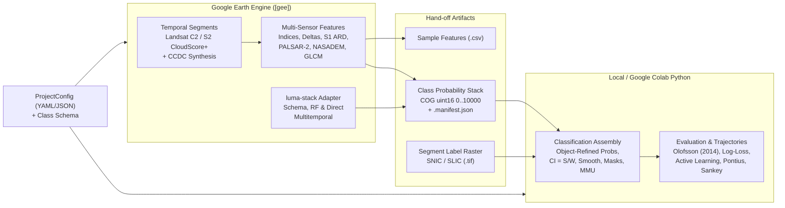

# LC_Framework

A unified, modular Python framework for **probability-based Land Use and Land Cover (LULC) mapping** across Google Earth Engine (GEE) and local/Google Colab environments.

`LC_Framework` spans three complementary paradigms built around a single standardized **`Class Probability Stack`** contract:
- **Pixel-Based Classification** (GEE Random Forest default + optional local Python ML backends)
- **Geo-Object Classification (GEOBIA)** (pluggable GEE SNIC or local SLIC segmentation → feature pooling → probabilistic classification → probability projection)
- **Object-Refined Pixel Probabilities** (adaptive hybrid blending of pixel probabilities with geo-object mean probabilities, `Confusion Index` $CI = S/W$, logit-space Bayesian smoothing, multi-resolution mask rules, and MMU filtering)

Every workflow stage is **independently usable** ([ADR-0005](docs/adr/0005-standalone-modular-subpackages.md)): for example, you can run standalone **Classification Assembly** or **Evaluation** on externally produced GeoTIFFs using only the lean core install — without installing or authenticating Google Earth Engine, `luma-stack`, or heavy ML libraries.

---

## Workflow Overview



---

## Modular Installation (Colab-Friendly)

Install only the slice you need so Google Colab stays fast and conflict-free:

```bash
# 1. Lean core (Classification Assembly, Evaluation, Config & I/O — NO GEE or ML required)
pip install "git+https://github.com/<your-org>/LC_Framework.git"

# 2. Add Google Earth Engine workflows (CCDC Temporal Segments, Multi-Sensor Features, GEE exports)
pip install "lc-framework[gee] @ git+https://github.com/<your-org>/LC_Framework.git"

# 3. Add interactive Plotly Sankey / plotting helpers
pip install "lc-framework[viz] @ git+https://github.com/<your-org>/LC_Framework.git"

# 4. Add local ML / RFECV / GEOBIA extras
pip install "lc-framework[ml,obia] @ git+https://github.com/<your-org>/LC_Framework.git"

# 5. Local editable development install (pytest, ruff, mypy)
pip install -e ".[gee,ml,obia,viz,dev]"
```

| Install Slice | Included Capabilities | Requires GEE? |
| :--- | :--- | :---: |
| **Core** (`lc-framework`) | `config`, `io`, `assembly`, `evaluation`, `luma_adapter` (lazy) | No |
| **`[gee]`** | `temporal` (Landsat/S2 + CCDC), `features` (indices/SAR/terrain/GLCM), `samples` (AlphaEarth), GEE RF & GEE SNIC | Yes |
| **`[ml]`** | Local CSV RFECV & local ML pixel classification (`RandomForest`, `ExtraTrees`, `LightGBM`, `XGBoost`) | No |
| **`[obia]`** | Local Python SLIC segmentation & pure `Geo-Object Classification` (GEOBIA) | No |
| **`[viz]`** | Interactive Plotly Sankey diagrams (core already has zero-dep SVG fallback) | No |
| **`luma-stack`** *(external)* | Installed separately from your org repo; integrated via `lc_framework.luma_adapter` | Yes |

---

## Repository Map

Every folder maps directly to a stage in a remote sensing mapping workflow:

```text
LC_Framework/
├── README.md                         ← Project overview, install matrix & quickstarts
├── GLOSSARY.md                       ← Canonical domain terms (no implementation jargon)
├── pyproject.toml                    ← Package metadata, optional extras, pytest/ruff/mypy
├── configs/
│   └── example_project.yaml          ← Study-area-agnostic ProjectConfig + Class Schema template
│
├── src/lc_framework/
│   ├── config.py                     ← ProjectConfig, ClassSchema (IDs, names, colors), EpochConfig
│   ├── io.py                         ← EECU-optimized uint16/float32 COG Probability Stacks, manifests,
│   │                                   Segment Label Raster overflow repair, CSV & tiled GEE exports
│   ├── luma_adapter.py               ← Zero-hard-dependency bridge to external luma-stack
│   ├── temporal/                     ← [Stage 1] Harmonized Landsat/S2, monthly medians & CCDC
│   ├── features/                     ← [Stage 2] Indices/deltas, S1/PALSAR SAR, terrain, GLCM, CSV export & local RFECV
│   ├── samples/                      ← [Stage 3] GEE AlphaEarth embedding Sample Augmentation & QA overlay
│   ├── classification/               ← [Stage 4] GEE MULTIPROBABILITY RF & local ML pixel backends + tiled COG inference
│   ├── obia/                         ← [Stage 5] Pluggable GEE SNIC / local SLIC Segmenter & pure GEOBIA
│   ├── assembly/                     ← [Stage 6] Object-Refined Pixel Probs, CI=S/W, Bayesian smooth, masks & MMU
│   └── evaluation/                   ← [Stage 7] Olofsson (2014) accuracy, log-loss, active learning & Sankey
│
├── notebooks/                        ← Ready-to-run Google Colab stage notebooks (00–07)
│   ├── 00_colab_setup_and_config.ipynb
│   ├── 01_gee_ccdc_and_features.ipynb
│   ├── 02_sample_augmentation_alphaearth.ipynb
│   ├── 03_feature_selection_rfecv.ipynb
│   ├── 04_pixel_classification_gee_and_local.ipynb
│   ├── 05_segmentation_and_geobia.ipynb
│   ├── 06_hybrid_classification_assembly.ipynb
│   └── 07_accuracy_and_trajectory_evaluation.ipynb
│
├── docs/
│   ├── methodology/                  ← Scientific formulas & methodological safeguards (01–06)
│   │   ├── 01_paradigm_selection_guide.md
│   │   ├── 02_ccdc_temporal_segmentation.md
│   │   ├── 03_probability_framework_and_hybrid.md
│   │   ├── 04_geobia_and_segmentation.md
│   │   ├── 05_embedding_sample_augmentation.md
│   │   └── 06_accuracy_and_change_evaluation.md
│   ├── api/                          ← Configuration, Colab & integration guides
│   │   ├── configuration.md
│   │   ├── luma_integration.md
│   │   └── colab_guide.md
│   └── adr/                          ← Architectural Decision Records (0001–0005)
│
└── tests/unit/                       ← Offline pytest suite (synthetic rasters, mocked EE, import isolation)
```

### Implementation Roadmap Status
- **Implemented (v1 complete)**: Core `ProjectConfig`/`Class Schema` & COG I/O, external `luma-stack` adapter, GEE Optical/CCDC `Temporal Segment` pipeline, Multi-Sensor Feature Stack & CSV Export, GEE AlphaEarth `Sample Augmentation`, Local CSV RFECV feature selection, GEE `MULTIPROBABILITY` RF & Local ML `[ml]` `Pixel-Based Classification`, Pluggable GEE SNIC / Local SLIC Segmentation & Pure `Geo-Object Classification` (GEOBIA), Standalone Hybrid `Classification Assembly` (`Object-Refined Pixel Probabilities`), Standalone Olofsson Accuracy & Multi-Epoch Trajectory Evaluation, plus Colab onboarding notebooks (`00`–`07`) and methodology/API guides.
- **Planned (v2)**: Optional local PyTorch/LoRA RSFM fine-tuning & inference (`[rsfm]`).

---

## Quickstarts

### 1. Standalone Hybrid `Classification Assembly` (No GEE Required)

Run **Object-Refined Pixel Probabilities** directly on any probability GeoTIFF (`uint16` `0..10000` or `float32` `0..1`) and segment raster — with or without a `ProjectConfig`:

```python
from lc_framework.assembly import run_hybrid_assembly

outputs = run_hybrid_assembly(
    prob_path="data/pixel_probs_2025.tif",
    segment_path="data/snic_segments_2025.tif",
    output_dir="outputs/hybrid_2025",
    tau=0.65,
    adaptive_sensitivity=0.60,
    encoding="uint16",
    mmu_table={1: 20, 2: 10, 3: 0},
)
print(outputs.probabilities, outputs.lulc, outputs.confusion_index, outputs.stability)
```

### 2. Standalone Evaluation & Multi-Epoch Trajectories (No GEE Required)

```python
from lc_framework.config import ProjectConfig
from lc_framework.evaluation import (
    analyze_multi_epoch_rasters,
    evaluate_probability_stack,
    export_sankey_html,
    suggest_active_learning_samples,
)

cfg = ProjectConfig.from_yaml("configs/example_project.yaml")

# Olofsson (2014) area-adjusted accuracy + multi-class probability log-loss
eval_res = evaluate_probability_stack(
    "outputs/hybrid_2025/pixel_probs_2025_hybrid_probs.tif",
    sample_coords_xy=[(500050.0, 8999950.0), (500350.0, 8999850.0)],
    y_true=[1, 5],
    class_schema=cfg.class_schema,
)
eval_res.save_reports("outputs/eval_2025")

# Spatially separated active learning candidates
candidates = suggest_active_learning_samples(
    "outputs/hybrid_2025/pixel_probs_2025_hybrid_probs.tif",
    n_samples=50,
    min_distance_m=250.0,
    method="confusion_index",
)

# Multi-epoch transition matrix, Pontius & Millones disagreement & Sankey HTML
traj = analyze_multi_epoch_rasters(
    {"2020": "outputs/lulc_2020.tif", "2025": "outputs/lulc_2025.tif"},
    class_schema=cfg.class_schema,
)
export_sankey_html(traj, "outputs/eval_2025/transitions_sankey.html")
```

### 3. GEE CCDC `Temporal Segment` & Multi-Sensor Feature Stack (`[gee]`)

```python
import ee
from lc_framework.config import ProjectConfig
from lc_framework.temporal import CCDCModel, CCDCParams, get_s2_collection, to_monthly_median
from lc_framework.features import FeatureStackSpec, build_feature_stack

ee.Initialize(project="your-gee-project-id")
cfg = ProjectConfig.from_yaml("configs/example_project.yaml")
aoi = ee.FeatureCollection(cfg.aoi_asset).geometry()

s2_col = get_s2_collection(aoi, "2020-01-01", "2025-12-31", reflectance_scale=10000.0)
monthly = to_monthly_median(s2_col, "2020-01-01", "2025-12-31")
model = CCDCModel.fit(monthly, params=CCDCParams.sentinel2())

features = build_feature_stack(
    aoi=aoi,
    year=2025,
    wet_image=model.synthetic(2025 + cfg.seasons["wet"]),
    dry_image=model.synthetic(2025 + cfg.seasons["dry"]),
    harmonics_image=model.harmonics(2025 + cfg.seasons["harmonic_mid"]),
    spec=FeatureStackSpec(include_s1=True, include_palsar=True, include_topography=True),
)
```

---

## Documentation

- **Domain Language**: [GLOSSARY.md](GLOSSARY.md)
- **Methodology Guides**:
  - [Paradigm Selection Guide: Pixel vs. Geo-Object vs. Hybrid](docs/methodology/01_paradigm_selection_guide.md)
  - [CCDC Temporal Segmentation & Synthetic Reflectance](docs/methodology/02_ccdc_temporal_segmentation.md)
  - [Probability Framework & Hybrid Classification Assembly](docs/methodology/03_probability_framework_and_hybrid.md)
  - [Pluggable Segmentation & Geo-Object Classification (GEOBIA)](docs/methodology/04_geobia_and_segmentation.md)
  - [AlphaEarth Embedding Sample Augmentation](docs/methodology/05_embedding_sample_augmentation.md)
  - [Accuracy Assessment, Active Learning & Multi-Epoch Change Evaluation](docs/methodology/06_accuracy_and_change_evaluation.md)
- **API & Integration Guides**:
  - [Project Configuration & Class Schema](docs/api/configuration.md)
  - [Integrating External `luma-stack`](docs/api/luma_integration.md)
  - [Colab Troubleshooting & EECU Optimization Guide](docs/api/colab_guide.md)
- **Colab Starter Notebook**: [00_colab_setup_and_config.ipynb](notebooks/00_colab_setup_and_config.ipynb)
- **Architectural Decisions**: [docs/adr/](docs/adr/) (`0001`–`0005`)

---

## Development & Offline Verification

All automated tests run offline without GEE credentials:

```bash
pytest
ruff check src tests
mypy src/lc_framework
```

## License

Licensed under the **GNU General Public License v3.0**. See [LICENSE](LICENSE).
