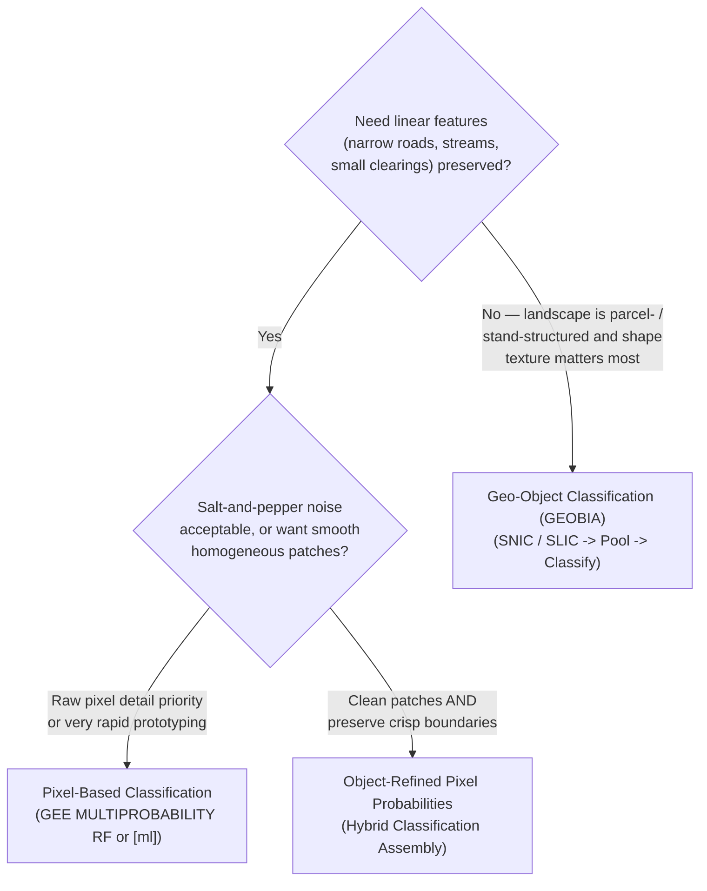

# Paradigm Selection Guide: Pixel-Based, Geo-Object, and Hybrid Mapping

## 1. Unified Probability-First Architecture

Every classification workflow in `LC_Framework` produces an interchangeable **`Class Probability Stack`** — a calibrated per-pixel probability simplex aligned strictly to a shared **`Class Schema`**, persisted as a `uint16` `[0, 10000]` (or `float32`) Cloud-Optimized GeoTIFF paired with `*.manifest.json`. Because the artifact contract is identical across all three paradigms, you can compare them directly using the same downstream evaluation suite (`evaluate_probability_stack`, `compute_thematic_accuracy`, `compute_log_loss`) or feed any of them into multi-epoch trajectory analysis.

---

## 2. Side-by-Side Comparison

| Dimension | `Pixel-Based Classification` (`paradigm="pixel"`) | `Geo-Object Classification` (`paradigm="geobia"`) | `Object-Refined Pixel Probabilities` (`paradigm="hybrid"`) |
| :--- | :--- | :--- | :--- |
| **Core unit** | Individual pixel spectral/SAR/terrain vector | Aggregated superpixel (`Segment Label Raster`) mean, std & morphology | Pixel probability vector adaptively blended with enclosing geo-object mean |
| **Primary modules** | `lc_framework.classification` (`gee_rf`, `local_ml`), `luma_adapter` | `lc_framework.obia` (`gee_snic`, `local_slic`, `geobia`) | `lc_framework.assembly` (`hybrid`, `smoothing`, `postprocess`) |
| **Linear & small features** | Preserves sub-segment narrow rivers, roads, small clearings | Blurred into surrounding geo-objects if smaller than segment scale | **Preserved** — disagreement damping automatically lowers object weight along sharp boundaries |
| **Homogeneous patches (forest, water)** | Can suffer single-pixel salt-and-pepper noise | Very clean cartographic regions | Smooth inside homogeneous objects weighted by `smoothness_weights` |
| **Morphological features** | None natively (only neighborhood GLCM) | Directly uses `area_px`, `compactness`, `extent`, `bbox_aspect` | Inherits spatial structure via geo-object pooling |
| **Training sample sensitivity** | Works directly from point samples (`sampleRegions` / CSV) | Requires segments to intersect enough pure samples (`min_purity`) | Needs only pixel probabilities + an unlabeled `Segment Label Raster` |
| **Where compute runs** | GEE cloud default (`MULTIPROBABILITY` RF) or local/Colab `[ml]` | Segmentation in GEE SNIC or local SLIC; classification locally `[obia]` | **100% local lean core** (no GEE or ML libraries needed) |

---

## 3. When to Choose Each Paradigm

### Choose `Pixel-Based Classification` when:
- **You need a fast baseline or direct GEE wall-to-wall run**: `train_gee_rf` + `predict_gee_probabilities` + `export_probability_tiles` runs completely inside Earth Engine on RFECV-selected bands.
- **You want non-RF tabular learners locally (`[ml]`)**: `tune_pixel_classifier` supports `ExtraTrees`, `LightGBM`, and `XGBoost` with spatial group CV (`StratifiedGroupKFold`) when point-sample geometry and spectral separability dominate.
- **Narrow, patchy, or transitional features matter** before any smoothing (e.g., logging trails, riparian strips, smallholder plots at 10 m resolution).

### Choose `Geo-Object Classification` (GEOBIA) when:
- **Object geometry & internal texture distinguish classes** (e.g., regular agricultural parcels vs. natural shrubland, plantation blocks vs. mixed secondary forest) where `compactness`, `extent`, and band standard deviations (`<band>_std`) improve separability.
- **Input imagery is high-resolution / noisy** (e.g., UAV or 10 m multi-sensor stacks) and you want classification decisions made strictly at polygon level.
- **You want decoupled GEE segmentation + local modeling**: export seamless/strided `GEESnicSegmenter` tiles once, then experiment rapidly in Colab with `pool_features_by_segments` and `classify_segments`.

### Choose `Object-Refined Pixel Probabilities` (Hybrid Assembly) — **Default Recommended for National/Regional LULC** — when:
- **You want both crisp parcel/linear fidelity and noise-free forest/water blocks** without losing calibrated `Confusion Index` ($S / W$) uncertainty estimates.
- **Classes vary in spatial homogeneity**: high `smoothness_weights` (e.g. Forest = `3.5`, Waterbody = `4.0`) strongly regularize uniform classes while heterogeneous mosaics (Agroforestry = `1.5`, Cropland = `1.0`) stay responsive to pixel evidence and adaptive disagreement damping ($\alpha = 0.60$).
- **You are assembling multi-epoch products**: running `Object-Refined Pixel Probabilities` + `MaskRule` + 8-connected MMU locally lets you iterate rapidly on cartographic cleanup in Colab on `uint16` COGs with zero extra GEE EECU spend.

---

## 4. Recommended End-to-End Recipes

1. **National / Provincial Multi-Epoch Production Pipeline**:
   - `temporal` (S2/Landsat CCDC `Temporal Segment` synthesis) → `features` (multi-sensor stack + CSV) → optional `samples` (AlphaEarth `Sample Augmentation`) → `features.rfecv` (local RFECV subset) → `classification.gee_rf` (`MULTIPROBABILITY` RF `uint16` COG export) + `obia.gee_snic` (`Segment Label Raster` export) → `assembly` (`Object-Refined Pixel Probabilities` + `Confusion Index` + MMU) → `evaluation` (Olofsson 2014 + Pontius transition trajectories).
2. **Offline / Colab-Only Regional Refinement**:
   - Load externally exported pixel `Class Probability Stack` GeoTIFF + SNIC/SLIC `Segment Label Raster` → `assembly.run_hybrid_assembly` (lean core install only) → `evaluation.suggest_active_learning_samples` → targeted sample collection.
3. **High-Resolution Parcel / Canopy Mapping**:
   - Feature stack GeoTIFF + point/vector samples → `obia.LocalSlicSegmenter` + `obia.run_geobia_classification` (`[obia]`) → `evaluation.evaluate_probability_stack`.

See [Probability Framework & Hybrid Assembly Methodology](03_probability_framework_and_hybrid.md) for the mathematical details of adaptive blending, `Confusion Index`, and logit-space smoothing.
