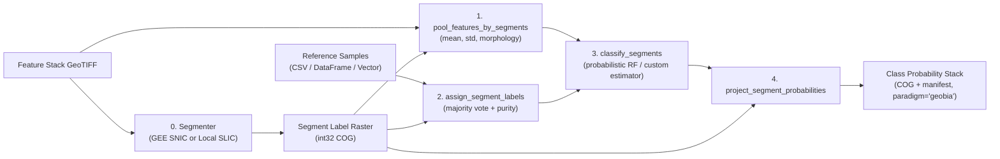

# Pluggable Segmentation & Geo-Object Classification (GEOBIA) Methodology

## 1. Role of Geo-Objects in `LC_Framework`

Every segmentation provider in `lc_framework.obia` implements a single pluggable `Segmenter` contract and emits a standardized single-band `int32` **`Segment Label Raster`** (nodata `0`, band description `"segment"`). Because the artifact contract is identical across providers, a single `Segment Label Raster` powers two distinct workflows:

1. **Pure `Geo-Object Classification` (GEOBIA)** — `Segment → Pool Features → Assign Labels → Classify Segments → Project Probabilities`, producing a canonical `Class Probability Stack` (`paradigm="geobia"`).
2. **`Object-Refined Pixel Probabilities` (Hybrid `Classification Assembly`)** — blending an existing pixel-level `Class Probability Stack` with per-segment mean probabilities via `lc_framework.assembly`.

---

## 2. Pluggable Segmentation Providers: GEE SNIC vs. Local Python SLIC

| Criterion | GEE SNIC (`GEESnicSegmenter`) | Local Python SLIC (`LocalSlicSegmenter`) |
| --- | --- | --- |
| **Execution runtime** | Cloud Google Earth Engine (`[gee]`) | Local Python / Colab CPU via `scikit-image` (`[obia]`) |
| **Best scale** | Regional to national mosaics (tens of thousands of $\text{km}^2$) | Small-to-medium scenes, UAV/VHR tiles, offline prototyping |
| **Algorithm** | Simple Non-Iterative Clustering (Achanta & Süsstrunk, 2017) | Simple Linear Iterative Clustering (Achanta et al., 2012) |
| **Input normalization** | Optional `[band_min, band_max]` clamp to `[0, 1]` | Per-band robust 2nd–98th percentile scaling (`convert2lab=False`) |
| **Pyramiding / Export** | `pyramidingPolicy={".default": "mode"}` (categorical-safe) | Single-band `int32` COG (`nodata=0`) |

> [!IMPORTANT]
> For multi-band Earth Observation stacks (e.g., Red, NIR, SWIR1, NDVI, SAR, DEM), `LocalSlicSegmenter` explicitly passes `convert2lab=False` to `skimage.segmentation.slic`. Leaving `convert2lab=None` causes `scikit-image` to misinterpret 3-band remote sensing stacks as sRGB images and distort spectral distances.

### Key Parameter Guidance

- **GEE SNIC (`SNICParams`)**:
  - `size`: seed spacing in pixels (e.g., `size=15` at 20 m $\approx$ 300 m seed spacing; `size=30` at 10 m).
  - `compactness`: higher values yield more regular, square-like polygons; `0.5–0.8` balances natural parcel and forest boundaries with spatial regularity.
  - `neighborhood_size`: defaults to `2 * size` (increase to `64` if tile seams appear at large `size`).
- **Local SLIC (`SLICParams`)**:
  - `n_segments`: target superpixel count across the valid raster footprint.
  - `compactness`: spatial-vs-spectral weight on normalized `[0, 1]` features (typically `0.5–10.0` depending on band count).
  - `start_label`: must be $\ge 1$ because `0` is reserved as `Segment Label Raster` nodata.

---

## 3. Tile ID Striding & GEE `int32` Overflow Handling

When exporting GEE SNIC segments across multiple geographic tiles, two failure modes occur if raw SNIC `clusters` IDs are exported naively:

1. **Cross-tile ID collisions**: Independent tiles can emit overlapping cluster IDs, causing unrelated polygons to merge during downstream pooling or blending.
2. **Signed 32-bit clamping overflow**: GEE internally encodes SNIC `clusters` as 64-bit seed hashes. Casting or striding directly into `int32` can exceed $2^{31} - 1 = 2{,}147{,}483{,}647$, clamping large regions into a single fused mega-segment or wrapping to negative integers.

`LC_Framework` solves both at export **and** at load time:

1. **Bounded Hashing + Deterministic Stride (Export Time)**:
   $$\text{id}_{\text{tile}}(i, x) = \bigl(|\text{cluster}_{64}(x)| \bmod M\bigr) + 1 + i \cdot S$$
   With defaults $M = 200{,}000{,}000$ (`hash_modulus`) and $S = 300{,}000{,}000$ (`id_stride`, strictly $S \ge M$), every tile $i$ occupies a disjoint integer interval while staying safely below $2^{31} - 1$ for regional grids. A `UserWarning` is emitted whenever $i \cdot S + M \ge 2^{31} - 1$ so operators can lower $M$ and $S$ for very large tile counts.
2. **Connected-Component Overflow Repair (Load Time)**:
   `lc_framework.io.repair_gee_int32_overflow` (enabled automatically in `read_segment_raster` and `GEESnicSegmenter.load_exported_segment_raster`) preserves valid wrapped negative IDs ($< -1$), isolates pixels clamped to $2^{31} - 1$ via connected-component labeling into collision-free negative IDs, and resets oversized fused mega-clusters (`> max_clamp_cluster_px`) to `0` so downstream workflows never flood across land-cover boundaries.

---

## 4. Pure Geo-Object Classification Pipeline

Pure `Geo-Object Classification` operates directly on geo-objects rather than individual pixels through a five-step pipeline (segmentation plus four GEOBIA stages in `lc_framework.obia.geobia`):

### Stage 1: Vectorized Feature & Morphology Pooling (`pool_features_by_segments`)
For each valid geo-object $s$ with pixel set $\Omega_s$ ($|\Omega_s| = n_s$) and every feature band $b$:

- **Per-object mean & standard deviation**:
  $$\mu_{s,b} = \frac{1}{n_s} \sum_{x \in \Omega_s} f_b(x), \qquad \sigma_{s,b} = \sqrt{\max\!\left(\frac{1}{n_s}\sum_{x \in \Omega_s} f_b(x)^2 - \mu_{s,b}^2,\; 0\right)}$$
- **Optional morphological descriptors** (`include_morphology=True`):
  - `area_px`: pixel count $n_s$.
  - `bbox_height`, `bbox_width`, `bbox_aspect`: bounding-box dimensions and rotation-invariant aspect ratio $\min(h, w) / \max(h, w) \in (0, 1]$.
  - `extent`: rectangularity $n_s / (h \cdot w) \in (0, 1]$.
  - `perimeter_px`: exact 4-neighbor pixel-edge boundary count $P_s$.
  - `compactness`: Polsby-Popper index $\operatorname{clip}\!\bigl(4\pi n_s / P_s^2,\, 0,\, 1\bigr)$.

### Stage 2: Majority-Vote Label Assignment (`assign_segment_labels`)
Training points (`DataFrame`/`.csv` with `(x, y, class_id)` — zero `geopandas` required) or vector polygons/points (`.gpkg`, `.geojson`, `.shp`, `GeoDataFrame` via lazy `geopandas` + `rasterio.features.rasterize`) are intersected with the `Segment Label Raster`. Each labeled segment receives:

- Majority-vote `class_id` (ties broken deterministically by smallest `class_id`),
- `sample_count`, and
- `purity` $= n_{\text{majority}} / n_{\text{total}}$, allowing mixed boundary segments to be filtered via `min_purity` (e.g., `0.75`).

### Stage 3: Probabilistic Object Classification (`classify_segments`)
A probabilistic classifier (default `RandomForestClassifier(class_weight="balanced_subsample")`, or any scikit-learn-compatible estimator implementing `fit` and `predict_proba`) is trained on labeled geo-objects and predicts class probabilities for every geo-object in the scene. Outputs are aligned strictly to `ClassSchema.class_ids` (zero-filling any schema class absent from training labels) and renormalized to sum to $1.0$.

### Stage 4: Probability Projection (`project_segment_probabilities`)
Per-object probability vectors are projected back onto the spatial grid of the `Segment Label Raster` via vectorized `np.searchsorted` lookup and written as a canonical **`Class Probability Stack`** COG (`uint16` `[0, 10000]` or `float32`) plus sidecar `*.manifest.json` (`paradigm="geobia"`). Unsegmented or nodata pixels remain nodata (`65535` / `NaN`).

---

## 5. Downstream Interoperability

Because `project_segment_probabilities` adheres strictly to the `Class Probability Stack` contract (ADR-0003), pure GEOBIA outputs feed directly into:

- `lc_framework.evaluation.evaluate_probability_stack` (Olofsson area-adjusted accuracy + multi-class log-loss),
- `lc_framework.evaluation.suggest_active_learning_samples` (uncertainty-driven sample collection),
- `lc_framework.assembly.apply_mask_rules` and `apply_mmu` (post-processing), and
- `lc_framework.evaluation.compute_transition_summary` (multi-epoch Pontius & Millones change evaluation).

## References

- Achanta, R., Shaji, A., Smith, K., Lucchi, A., Fua, P., & Süsstrunk, S. (2012). SLIC Superpixels Compared to State-of-the-Art Superpixel Methods. *IEEE TPAMI*, 34(11), 2274–2282.
- Achanta, R., & Süsstrunk, S. (2017). Superpixels and Polygons Using Simple Non-Iterative Clustering. *IEEE CVPR*, 4895–4904.
- Blaschke, T. (2010). Object based image analysis for remote sensing. *ISPRS Journal of Photogrammetry and Remote Sensing*, 65(1), 2–16.
